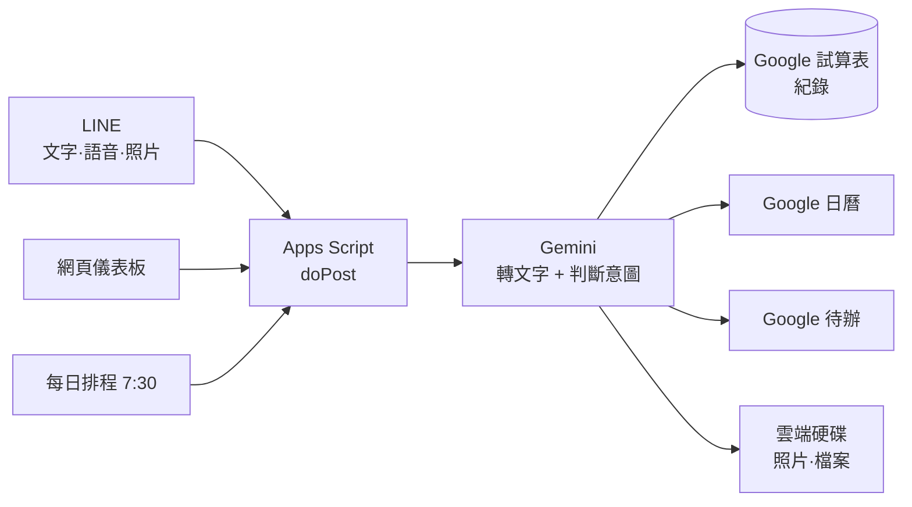

# LINE 小幫手（GAS × Gemini）

給老師和行政人員用的個人助理。對著 LINE 隨口說一句話，它自己判斷要記下來、開行程，還是加待辦。

**不用寫程式、不用租主機、不用付月費。** 全部跑在 Google Apps Script 上，用 Google 帳號就能架起來。

```
你：（語音）「下週三下午兩點在會議室開領域會議，記得先印好資料」

小幫手：📝 已記錄：下週三領域會議
        📅 已加入日曆：領域會議（9/2 (三) 14:00–15:00）
        ✅ 已加入待辦：印好會議資料

        都排好了，別忘了印資料喔！
```

---

## 它能做什麼

| 你丟給它 | 它做的事 |
|---|---|
| 🎙️ 語音 | 轉逐字稿 → 判斷要不要開行程／待辦 |
| 💬 文字 | 同上 |
| 📷 照片 | 讀出公文、通知單、研習海報上的字，抓出日期和該辦的事 |
| 📄 PDF | 同上 |
| 📎 其他檔案 | 存進雲端硬碟，試算表記下連結 |
| ❓ 問問題 | 「期中考什麼時候」「9/30 有什麼事」→ 查資料回答你 |

還有：

- **每天早上 7:30 主動推播**當日行程、待辦、今天的課、本週校內事項
- **網頁儀表板**——所有資料一頁看完，可搜尋、可篩選、可直接補記錄
- 所有紀錄都進 Google 試算表，資料是你自己的

---

## 運作方式



沒有伺服器、沒有資料庫、沒有第三方服務。你的資料只在你自己的 Google 帳號裡。

---

## 需要準備

| 項目 | 說明 | 費用 |
|---|---|---|
| Google 帳號 | 跑 Apps Script、存資料 | 免費 |
| LINE 官方帳號 | 建立 Messaging API | 免費 |
| Gemini API Key | 在 [Google AI Studio](https://aistudio.google.com/apikey) 申請 | 有免費額度 |

**費用實測**：一天記十幾則、用 `gemini-3.5-flash`，免費額度綽綽有餘。LINE 的主動推播每月有免費額度（目前 200 則），每天一則早報一個月才 30 則。回覆訊息（你傳它才回）完全不計費。

**安裝時間**：第一次大約 30～40 分鐘，卡關多半在 LINE 後台那幾個設定。

---

## 開始安裝

完整的圖文步驟在 **[docs/安裝手冊.md](docs/安裝手冊.md)**，照著做就行。

大致流程：

1. 申請 Gemini API Key
2. 建立 LINE 官方帳號並啟用 Messaging API
3. 建立 Apps Script 專案，貼上 `dist/全部程式碼.gs` 和 `src/Dashboard.html`
4. 填入金鑰、執行 `初次設定`
5. 部署成網頁應用程式，把網址貼回 LINE 的 Webhook

熟 [clasp](https://github.com/google/clasp) 的話：

```bash
cp .clasp.json.example .clasp.json   # 填入你的 scriptId
clasp push
```

---

## 專案結構

```
src/                     原始碼（改這裡）
  00_Config.gs           設定與金鑰
  01_Webhook.gs          LINE 訊息主流程
  02_Gemini.gs           轉文字、判斷意圖
  03_Actions.gs          寫試算表、開日曆、加待辦、存硬碟
  04_Line.gs             LINE API
  05_DailyBrief.gs       每日 7:30 推播
  06_WebApp.gs           儀表板後端
  07_Teaching.gs         課表與教學進度（選用）
  08_School.gs           學校行事曆查詢（選用）
  Dashboard.html         儀表板前端

dist/全部程式碼.gs        合併版，貼一次就好
tools/build.py           重新產生合併版
tools/parse_calendar_pdf.py   學校行事曆 PDF → CSV
tools/make_richmenu.py        產生 LINE 圖文選單底圖
examples/                範例資料
docs/                    安裝、客製化、疑難排解
```

改完 `src/` 記得跑 `python tools/build.py` 重新產生合併版。

---

## 兩個選用模組

不需要的話，把對應的 `.gs` 刪掉就好，其他功能不受影響。

### 📘 教學模組（`07_Teaching.gs`）

給有固定課表的老師：

- 儀表板顯示**本週每個班的教學進度和注意事項**，可直接編輯
- 每日推播附上**今天有哪幾節課、哪些班**
- **教學相關的行程自動進教學專用日曆**，不跟私人行程混在一起

判斷依據是你設定的科目——提到班級、單元、實驗、教具、月考、備課就歸類為教學。

而且讀得懂**班級代號**：課表寫「三年二班」，你說「302」、「3年2班」它都知道是同一班，
寫進日曆時還會統一成正式名稱。對照表從課表自動推出，不用自己維護。

### 🏫 學校行事曆模組（`08_School.gs`）

把學校發的學期行事曆 PDF 變成可以問的資料：

```bash
pip install pymupdf
python tools/parse_calendar_pdf.py 你的行事曆.pdf -o 學校行事曆.csv
```

匯入試算表後就能問：

> 「期中考什麼時候」
> 「家長日哪一天」
> 「下週學校有什麼事」

回答時會把**整份行事曆**交給 Gemini 看，所以就算行事曆寫「期中評量」而你問「期中考」也找得到。標著「暫定」的它會主動提醒你。

⚠️ 這支腳本是針對「橫式、有格線、欄位是週次／日期／各處室」的表格寫的。排版差太多可能要調整，先用 `--dump` 看抓到什麼。**匯入後務必自己對一次紙本**，PDF 排版千奇百怪。

---

## 客製化

最常改的幾個地方（詳見 [docs/客製化.md](docs/客製化.md)）：

| 想改什麼 | 改哪裡 |
|---|---|
| 助理的名字 | `00_Config.gs` 的 `助理名稱` |
| 判斷規則（什麼算行程、什麼算待辦） | `02_Gemini.gs` 裡 `問Gemini_` 的中文提示 |
| 分類項目（教學／行政／學生…） | 同上 |
| 推播時間 | `00_Config.gs` 的 `DAILY_PUSH_HOUR` |
| 用哪個 Gemini 模型 | `00_Config.gs` 的 `GEMINI_MODEL` |

判斷規則全部是**中文寫的提示詞**，不用懂程式也改得動。

---

## LINE 圖文選單

附一支產生選單底圖的腳本，把常用功能做成聊天室下方的六格選單：

```bash
pip install pillow
python tools/make_richmenu.py
```

產生 `圖文選單.png`（2500×1686），上傳到 LINE 官方帳號後台即可。
改文字或配色就改腳本最上面的 `CELLS`。設定步驟見 [docs/安裝手冊.md](docs/安裝手冊.md)。

---

## 安全性

**請務必了解這幾點：**

- Apps Script 的 `doPost` **拿不到 HTTP 標頭**，所以無法驗證 LINE 的簽章。防護靠的是「`/exec` 網址不外流」。**不要把網址貼到公開場合。**
- 儀表板另外加了一道金鑰（網址要帶 `?k=xxx`），沒帶就只回一行狀態文字。
- 金鑰請只放在 Apps Script 的**指令碼屬性**，不要寫在程式碼裡，更不要 commit 上 GitHub。
- 要給整個處室共用的話，建議用公用帳號建立，不要用個人帳號。

`.gitignore` 已經先擋掉 `.clasp.json`、`*.key`、`學校行事曆.csv` 這類檔案。

---

## 疑難排解

最常見的三個：

**改完程式碼沒生效** → 一定要重新部署，而且「部署 → 管理部署作業 → 鉛筆 → **版本要選『新版本』**」。直接按部署但版本沒換等於沒改。

**LINE 完全沒回應** → 檢查 LINE 官方帳號後台的「自動回應訊息」是不是關掉了，它會搶在小幫手前面回罐頭訊息。

**Gemini 回 404** → 模型被 Google 退場了。執行 `檢查Gemini模型` 看你的 key 現在能用哪些，改掉 `GEMINI_MODEL` 即可。

更多狀況見 [docs/疑難排解.md](docs/疑難排解.md)。專案內建八個診斷函式，在 Apps Script 直接執行就能查。

---

## 授權

MIT。歡迎自由取用、修改、散布。

如果你把它改成適合貴校的版本，歡迎回報使用心得或送 PR——尤其是**其他學校的行事曆 PDF 格式**，多幾種樣本可以讓解析腳本更通用。
